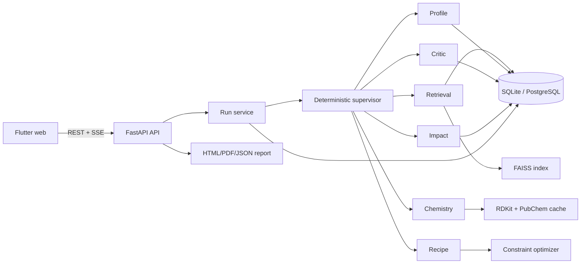

# AlgaMask full implementation plan

Status: planning baseline  
Scope: a functional, evidence-grounded experimental decision application for one 40–50 g spirulina/chlorella protein-bar matrix  
Delivery method: capability phases with acceptance gates; no calendar assumptions

## 1. Product proof

The product is complete when a user can select spirulina, chlorella, or a blend; set inclusion, serving mass, flavour direction, allergens, nutrition targets, and formulation limits; run the six-role workflow; inspect the evidence and molecular-sensory reasoning; receive three safe, distinct, mass-balanced formulations; compare B0, A0, and A1; enter blinded sensory results; and export a reproducible report and JSON record.

The final proof statement must be generated from stored values:

> AlgaMask generated an evidence-backed masking formulation that enabled X% spirulina-chlorella inclusion in a protein bar, changed [nutrition metric] by Y% versus B0, and changed overall sensory acceptance by Z% versus A0.

Every value must carry exactly one evidence-status label: `database_derived`, `literature_derived`, `calculated`, `ai_predicted`, `assumed_for_demo`, or `experimentally_measured`. Unknown values remain null. The application may generate the statement only when X, Y, Z, their comparison bases, and their statuses are present.

### Explicit product boundary

Version 1 supports one protein-bar matrix, spirulina, chlorella, and their blend. It proposes food-grade ingredient combinations and screening ranges. It does not create novel molecules, claim receptor-level cancellation, make medical claims, or label predicted doses as validated.

## 2. Current baseline

Already functional:

- Flutter web input form and result view.
- FastAPI health, run, run lookup, and print-ready report endpoints.
- Six deterministic mock roles and a visible completed trace.
- Three synthetic formulations plus B0 and A0 controls.
- Basic ingredient membership, exclusion, positive-mass, and mass-balance checks.
- Empty reviewed-data CSV contracts, demo scenarios, API tests, and widget tests.

Still synthetic or absent:

- Scientific records, nutrition values, screening ranges, and citations.
- PubChem/RDKit molecular features and multimodal fusion.
- Embeddings, vector index, hybrid retrieval, and reranking.
- Real constrained search and complete safety validation.
- LLM provider, typed agent outputs, retries, revision loop, and degraded fallback.
- Persistent runs, streaming progress, experiment entry, impact calculations, and real PDF export.
- Deployment, monitoring, backup, and reproducible index/data builds.

## 3. Recommended engineering decisions

These defaults keep the proof reproducible and locally runnable while leaving clean production seams.

| Area | Decision | Reason |
|---|---|---|
| Runtime | Pin Python 3.12 and the Flutter stable channel | RDKit and scientific-package compatibility; reproducible CI |
| API | FastAPI with versioned `/api/v1` routes | Preserves the current stack and makes contracts explicit |
| Database | SQLAlchemy repository layer; SQLite locally/tests, PostgreSQL in deployment | Simple local setup with a production migration path |
| Migrations | Alembic | Reviewable schema evolution |
| Reviewed source files | CSV remains the human-review/import format; database is the runtime source | Keeps provenance inspectable without making joins and writes fragile |
| Molecular computation | RDKit with fixed Morgan fingerprint parameters and cached PubChem responses | Reproducible descriptors and offline demos |
| Embeddings | Provider interface; local sentence-transformer default | App can work without an embedding API key |
| Vector search | FAISS artifact plus database metadata | Offline-capable, small corpus, deterministic versioning |
| LLM | Provider interface with an OpenAI-compatible adapter and deterministic fake provider | Live agent behavior is configurable and testable without network calls |
| Orchestration | Explicit state machine in application code | Bounded retries/revisions and inspectable behavior |
| Background execution | In-process task runner for the single-instance proof; durable job queue only when deployment needs multiple workers | Avoids premature infrastructure while retaining an upgrade boundary |
| Progress transport | Server-sent events (SSE) with polling fallback | One-way progress is simpler than WebSockets |
| Report | Server-rendered HTML plus deterministic PDF generation | Browser preview and portable artifact from the same data |
| Secrets | Environment variables locally; deployment secret store later | No credentials in Git or run records |

Before implementation phase 5, choose the live LLM provider/model and budget. Before release, choose the deployment target. These choices do not block phases 1–4.

## 4. Target architecture



### Backend modules

```text
services/algamask/
  api/                 versioned routes and dependency wiring
  domain/              typed entities, enums, scores, statuses
  repositories/        database interfaces and implementations
  ingestion/           CSV validation, import, review and dataset builds
  molecular/           PubChem client/cache, RDKit descriptors/fingerprints
  retrieval/           embedding, FAISS, filters, diversity reranker
  formulation/         candidate scoring, search, repair and validation
  agents/              six role contracts and implementations
  orchestration/       state machine, retry/revision policy, events
  impact/              nutrition and sensory calculations
  reporting/           report model, HTML, PDF and JSON
  providers/           model and embedding adapters
```

### Flutter features

```text
apps/flutter/lib/
  core/                API client, models, configuration, error handling
  features/run_setup/  goal and constraint form
  features/run_trace/  live state and role outputs
  features/sensory/    molecular-sensory map
  features/formulas/   comparison, scores, warnings and citations
  features/evidence/   retrieval details and source records
  features/impact/     B0/A0/A1 nutrition and sensory comparison
  features/trials/     blinded sensory data entry/import
  features/reports/    report preview and downloads
```

## 5. Stable domain and API contracts

Define these before real data or UI expansion so every later phase builds on stable types.

### Core domain objects

- `DatasetVersion`: version, content hashes, created time, reviewer, status.
- `Source` and `EvidenceChunk`: licence note, exact location, support type, review status.
- `AlgaeSpecies`, `Compound`, `CompoundObservation`, `SensoryDescriptor`, `CompoundSensoryLink`.
- `Ingredient`, `IngredientNutrition`, `ScreeningBound`, `Allergen`.
- `Run`, `RunConstraint`, `AgentStep`, `RetrievedEvidence`, `Candidate`, `Formulation`, `ValidationIssue`.
- `ControlPrototype`: B0, A0, and selected A1, with process metadata.
- `SensoryTrial`, `SensoryObservation`, `ImpactMetric`, `ReportArtifact`.

All quantitative fields require a value, unit, source/status, and nullability rule. Percent fields must state whether they are mass percent, relative change, or score percent. Scores must define their 0–1 normalization.

### API surface

| Method | Route | Purpose |
|---|---|---|
| GET | `/api/v1/health` | process and dependency health |
| GET | `/api/v1/catalog` | approved algae, ingredients, allergens, flavour directions, constraints |
| POST | `/api/v1/runs` | validate a request and enqueue/start a run |
| GET | `/api/v1/runs/{id}` | complete stored run record |
| GET | `/api/v1/runs/{id}/events` | SSE progress and terminal event |
| POST | `/api/v1/runs/{id}/cancel` | bounded cancellation |
| GET | `/api/v1/runs/{id}/report.json` | immutable structured export |
| GET | `/api/v1/runs/{id}/report.pdf` | generated PDF artifact |
| POST | `/api/v1/trials` | create a blinded trial for stored formulations |
| POST | `/api/v1/trials/{id}/observations` | submit validated panel observations |
| GET | `/api/v1/trials/{id}/summary` | descriptive statistics and limitations |
| POST | `/api/v1/admin/datasets/validate` | validate a candidate dataset build |
| POST | `/api/v1/admin/datasets/publish` | publish an approved immutable dataset version |

Admin dataset operations are CLI-only first. Exposing them in a UI is optional and must not block the experiment product.

## 6. Implementation phases and proof gates

The detailed acquisition, schema, review, validation, licensing, and versioning rules for the scientific corpus are defined in [DATASET_PLAN.md](DATASET_PLAN.md). Phase 2 must follow that plan.

Each phase starts only after the previous gate is green. Every phase must preserve a runnable vertical slice.

### Phase 1 — Engineering foundation and typed contracts

Work:

- Pin Python 3.12 and exact dependency versions; add CI for backend and Flutter.
- Introduce application settings with `mock`, `offline`, and `live` modes.
- Split Pydantic models into request, domain, persistence, event, and response contracts.
- Add structured error codes and a single API error envelope.
- Add SQLAlchemy, Alembic, repositories, SQLite configuration, and transactional tests.
- Persist runs, requests, trace steps, formulations, validation issues, and artifacts.
- Move routes to `/api/v1`; keep temporary compatibility aliases until Flutter migrates.
- Generate or maintain a machine-readable OpenAPI client contract for Flutter.

Gate:

- A run survives API restart and returns exactly the same record.
- Schema migration works from an empty database.
- Mock mode still completes end to end.
- Backend unit/integration tests, Flutter analyze/tests, and web build pass in CI.
- No untyped `dict` remains in public API response models.

### Phase 2 — Reviewed data pipeline and provenance

Work:

- Convert all CSV headers into typed import schemas and controlled enums.
- Add cross-file validation for IDs, joins, units, ranges, duplicates, nulls, source links, and review status.
- Add a two-stage build: `validate` produces a review report; `publish` produces an immutable version and hashes.
- Add source-location fields and reviewer/date fields where current schemas are insufficient.
- Seed and manually review two algae records, five sensory groups, a baseline recipe, B0/A0 control definitions, and the permitted ingredient library.
- Curate the target minimum: 15–30 compounds, 20–40 ingredients, 20+ evidence chunks, 10–20 nutrition records, and decisive source metadata.
- Store only permitted source text; use reviewer-written evidence notes for restricted material.
- Add a data dictionary explaining every column, enum, unit, and status.

Gate:

- The import fails closed on an orphan, duplicate, invalid unit, unapproved production row, or missing source.
- Every runtime scientific/nutrition record resolves to a source and dataset version.
- Missing nutrition values stay null through import, API, calculation, and UI.
- A reviewer can reproduce the dataset build from Git-tracked reviewed files.
- Scientific review signs off the seed records; engineering tests cannot substitute for that review.

### Phase 3 — Molecular features and multimodal sensory map

Work:

- Add a rate-limited PubChem client, response cache, retry policy, and offline-cache-only mode.
- Resolve and verify CID and canonical SMILES; reject identity mismatches explicitly.
- Calculate RDKit molecular weight, logP, H-bond counts, TPSA, and Morgan fingerprints with stored software version, radius, and bit length.
- Embed controlled descriptor text, synonyms, evidence note, and product matrix.
- Implement late-fusion scoring with configurable published weights and renormalization when modalities are absent.
- Calculate confidence from modality coverage and evidence strength; never infer sensory equivalence from Tanimoto similarity alone.
- Return a graph-ready map: species → observations → compounds → descriptors → supported intervention candidates.
- Build the Flutter sensory map with details for molecular, text, literature, matrix, and level components.

Gate:

- Same SMILES and parameters produce identical fingerprints.
- Invalid structures and unresolved identities fail visibly.
- All score components are 0–1 and missing modalities lower confidence.
- Every displayed edge identifies its evidence/status.
- Offline mode reproduces the fixed demo map without network access.

### Phase 4 — Hybrid RAG retrieval

Work:

- Implement embedding-provider and vector-index interfaces.
- Build a versioned FAISS index from approved chunks only; store dataset hash, model name/version, dimensions, normalization, and chunk IDs.
- Implement filters for species, product matrix, ingredient allowance, evidence type, and review status.
- Retrieve a larger candidate set; rerank on semantic relevance, evidence strength, matrix match, recency, and source diversity.
- Return 5–8 diverse chunks for both diagnosis and intervention.
- Log the original query, rewritten query, filters, scores, rejected candidates, and selected chunks.
- Add insufficient-evidence behavior; the application must not fabricate a supported intervention.
- Build evidence drawer UI with the source, exact location/note, support relationship, score components, and external link.

Gate:

- Golden queries return their expected source family near the top.
- Unapproved rows, wrong species/matrix, and missing-source chunks are impossible to retrieve.
- One source cannot monopolize the result set when alternatives exist.
- Every generated claim citation exists in the retrieved set.
- Empty or weak retrieval gives a clear insufficient-evidence result.
- The frozen demo index runs offline and is rebuildable byte-for-byte or with documented deterministic tolerance.

### Phase 5 — Constraint-safe formulation engine

Work:

- Define the exact baseline recipe and the algebra for B0, A0, and candidate variants.
- Implement candidate scoring from molecular fit, sensory complementarity, evidence, matrix compatibility, and processing compatibility.
- Implement small beam/grid search with at most three intervention roles: aroma, taste balance, and matrix/support.
- Enforce allowed ingredients, form-specific bounds, complete allergens, serving mass, algae target, added sugar, calories, and user constraints.
- Treat hard violations as rejection. Implement deterministic mass repair only within a designated adjustable base ingredient and its bounds.
- Calculate named score components and penalties; keep raw inputs so rankings are auditable.
- Require meaningful diversity between three returned formulations.
- Add deterministic seed/version fields and exact reproducibility tests.

Gate:

- Every accepted formulation has exact mass balance and requested algae inclusion within stated tolerance.
- Excluded allergens never appear, including indirect ingredient allergen flags.
- Every intervention stays inside reviewed bounds and has a retrieved support record or an explicit non-mechanistic formulation role.
- Same inputs, dataset/index versions, configuration, and seed reproduce the ranking.
- No feasible solution returns structured rejection reasons and suggested constraint relaxations; it never silently weakens a hard rule.

### Phase 6 — Real agent workflow and supervisor

Work:

- Define typed input/output contracts for Profile, Retrieval, Chemistry, Recipe, Critic, and Impact roles.
- Implement a `ModelProvider` abstraction, deterministic fake provider, and selected live adapter.
- Version system prompts and record provider, model, temperature, prompt version, token use, duration, and errors.
- Use models for structured extraction, query rewriting, explanations, and proposal assistance only.
- Keep identifiers, units, constraints, arithmetic, final scores, and safety decisions deterministic.
- Implement allowed state transitions, one schema-retry per role, at most two Critic revisions, cancellation, timeouts, and deterministic fallbacks.
- Persist an append-only event/trace record and emit SSE progress.
- Make Critic verify source coverage and remove unsupported mechanism, validation, medical, or exact-dose claims.

Gate:

- Every role output validates before entering the next state.
- Retry and revision limits cannot loop indefinitely.
- Critic rejection blocks approval and reporting of that formulation.
- A controlled provider failure completes in degraded mode with an honest trace.
- Deterministic constraints always override model output.
- Flutter displays progress, failure, retry, revision, degraded, cancelled, and completed states without becoming stuck.

### Phase 7 — Nutrition, trials, and measurable impact

Work:

- Implement nutrition arithmetic per 100 g, per serving, and protein grams per 100 kcal from the exact formula.
- Propagate null ingredients/nutrients to `unknown` with coverage information rather than substituting zero.
- Add B0/A0/A1 selection and immutable recipe snapshots.
- Add trial creation, random blinding codes, panelist pseudonymous codes, preparation/process metadata, and 1–9 field validation.
- Add CSV import and Flutter form entry for sensory observations.
- Calculate sample size, mean, standard deviation/range, and directional percentage change. Do not label significance without a justified test.
- Mark calculated nutrition and experimentally measured sensory outcomes distinctly.
- Allow reranking only through a new run/version so original results remain reproducible.

Gate:

- Hand-calculated fixtures match nutrition and sensory summaries.
- B0, A0, and A1 identities cannot be mixed or changed after trial data exists.
- The denominator-zero case and incomplete panel are handled explicitly.
- Trial export contains no direct participant identity.
- The proof statement is unavailable until all required values and labels are valid.

Human checkpoint: physical preparation and participant testing cannot be completed by software. A responsible project owner must approve the protocol, ingredient/allergen information, consent approach, and recorded results.

### Phase 8 — Complete Flutter experience

Work:

- Replace raw maps with generated typed Dart models and repositories/state management.
- Load allowed inputs from `/catalog`; remove hard-coded options.
- Split the app into setup, live run, sensory map, formulations, evidence, impact, trials, and report views.
- Add responsive phone/desktop layouts, navigation, empty/loading/error/degraded states, retry, cancellation, and run history.
- Show formula deltas against A0, score components, warnings, confidence, evidence badges, and status labels next to each value.
- Preserve limitations beside results and expose source links and exact provenance.
- Add accessible labels, keyboard navigation, contrast checks, and overflow tests for long chemical/source names.
- Add local saved-run fallback for the fixed demonstration.

Gate:

- A new user can complete setup → run → inspect → select A1 → record/import trial → export report without developer tools.
- Common phone and desktop widths have no overflow or inaccessible controls.
- All loading and terminal states are recoverable and understandable.
- The UI never presents null, predicted, calculated, or measured values under the wrong label.

### Phase 9 — Reporting, reproducibility, and audit

Work:

- Define one immutable `ReportModel`; render HTML, PDF, and JSON from it.
- Include goal/constraints, dataset/index/model versions, sensory map, evidence, formulations, validation, controls, nutrition, trial summary, limitations, confidence, and next experiment.
- Include an appendix with input, trace, calculation definitions, retrieved chunk/source IDs, and content hashes.
- Store artifacts with checksum, creation time, MIME type, and run ID.
- Add a reproducibility command that replays deterministic components and reports any difference.

Gate:

- HTML, PDF, JSON, database record, and Flutter values match for the same run.
- PDF rendering has no clipped or overflowing content.
- A report can be regenerated from stored snapshots after source data changes.
- The headline statement exactly matches stored calculation outputs and status labels.

### Phase 10 — Security, operations, and release

Work:

- Add request size limits, strict CORS configuration, security headers, structured logs, correlation IDs, and rate limiting where exposed.
- Keep secrets out of logs, traces, exports, fixtures, and Git; add secret scanning.
- Add health/readiness checks for database, index, model provider, PubChem cache, and report renderer.
- Add Docker build(s), migration/startup commands, environment templates, backup/restore, and deployment documentation.
- Add CI gates: lint, types, tests, migration check, dataset validation, index build check, Flutter build, dependency audit, and container smoke test.
- Add telemetry for run duration, state failures, degraded runs, retrieval quality fixtures, and report failures without collecting panelist identity.
- Prepare the fixed demo scenario, constraint scenario, higher-inclusion scenario, saved run, report, screenshots, and offline data/index cache.

Gate:

- Clean environment setup can build data/index, migrate, start, run, and generate a report from documented commands.
- Deployment and offline build produce the same deterministic calculations for the fixed scenario.
- Backup restore is tested.
- No critical vulnerability, data/provenance test failure, or release-blocking UI defect remains.
- The three demo scenarios complete with expected status and trace.

## 7. Test strategy

### Unit tests

Use for schema validators, score normalization, molecular determinism, nutrition arithmetic, formula constraints, mass repair, state transitions, label propagation, and descriptive statistics.

### Contract tests

Validate OpenAPI responses, Flutter decoding, provider adapters, repository behavior on SQLite/PostgreSQL, and report-model compatibility.

### Integration tests

Cover CSV → database publication, dataset → FAISS build, hybrid retrieval, complete supervisor runs, retry/fallback, persistence, SSE, PDF generation, and trial summary.

### Golden scientific tests

Maintain reviewer-approved examples for compound identity, known query retrieval, sensory links, candidate ranking expectations, and fixed B0/A0/A1 calculations. Golden updates require a reason and reviewer identity.

### End-to-end tests

Automate default success, allergen exclusion, insufficient evidence, provider failure/degraded mode, invalid concentration, trial entry, report export, and saved offline run. Keep one small real-provider smoke test outside ordinary CI; all standard CI remains deterministic.

## 8. Work discipline

For each implementation phase:

1. Write or approve the phase contract and acceptance fixtures.
2. Add the smallest backend capability and migration.
3. Add meaningful tests for the risk introduced.
4. Connect the Flutter flow with complete state handling.
5. Run the full existing suite and the new phase gate.
6. Update API/data documentation and sample fixtures.
7. Commit one coherent, reviewable vertical slice.
8. Do not begin the next phase while the gate is red.

Keep scientific content changes separate from engine changes when possible. A dataset version, index version, prompt version, and code commit must identify every result.

## 9. Definition of done

The full application is done only when:

- all ten phase gates pass;
- real reviewed records replace every synthetic scientific fixture in live mode;
- a live run completes all six roles with bounded failure behavior;
- three formulations are evidence-linked, constraint-valid, distinct, and reproducible;
- B0, A0, and A1 calculations and trial summaries are stored and visible;
- the report reproduces the app and database values with correct status labels;
- the fixed scenario works online and from its offline fallback;
- setup, operations, dataset/index rebuild, experiment entry, and release are documented;
- the final proof statement is backed by the selected formulation and actual stored results.

## 10. First execution slice

Implementation should now begin with Phase 1 only. The first code change should pin the runtime, introduce typed settings and persistence, add Alembic, store the existing mock run/trace/formulations, expose `/api/v1`, migrate Flutter to the versioned contract, and add CI. This creates the durable foundation required by every scientific and agent feature that follows.
